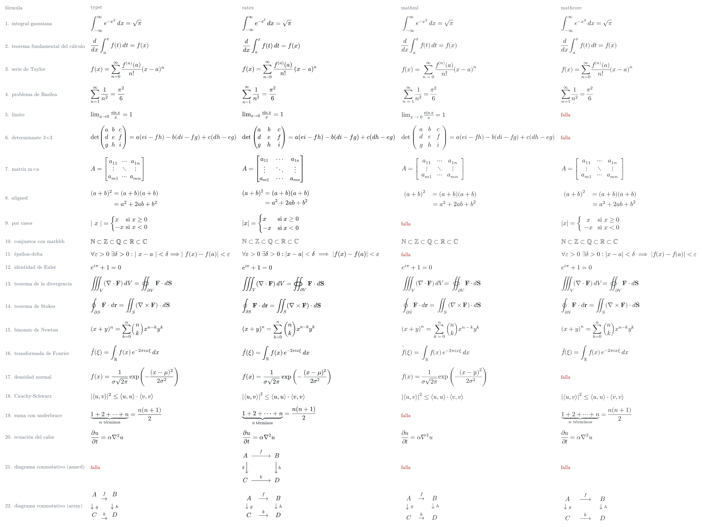
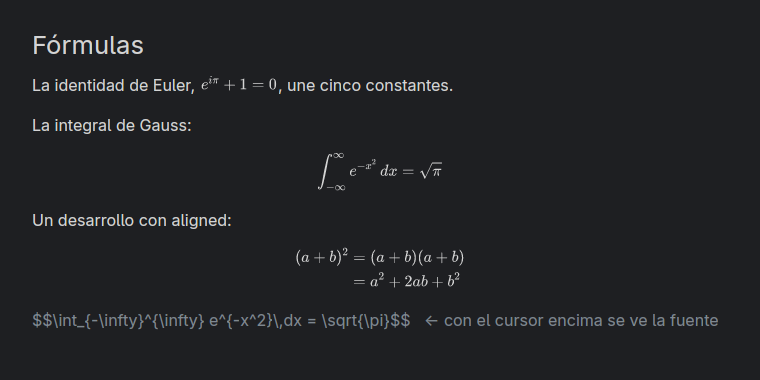

# 08 — Fórmulas LaTeX: spike

> [!WARNING]
> **Estado: pendiente de revisión de Alex.** Es un spike: nada de aquí está decidido ni entra al roadmap. La recomendación está marcada **(propuesta)** y la decisión final la toma Alex. No implementes nada de este documento hasta que se quite este aviso.

> Spike del 2026-10-18. Versiones, fechas y licencias de la API de crates.io de ese día. Los números son míos, en release, en una máquina de escritorio x86_64 con Linux (la de [performance.md](../performance.md)). El código está en [`spikes/math/`](../../spikes/math/README.md), fuera del workspace: no toca el editor ni el binario.
> Construye sobre [03](03-core-architecture.md) §2 (el scanner de `metalmind-syntax` y el plan del live preview) y el estilo del markdown que entró con la PR #76 (03 §2, "Estilo en el editor" y "Plan del paso 2"), que deja marcado en el estilo de cada línea lo que el live preview va a ocultar.

## TL;DR

- **Objetivo**: `$…$` en línea y `$$…$$` en bloque dentro de las notas, como en Obsidian. Documentos LaTeX completos, no.
- **Recomendación (propuesta): RaTeX** (`ratex-parser` + `ratex-layout` + `ratex-render`, con las fuentes de KaTeX embebidas). Es el único camino que compuso las 22 fórmulas de la prueba, diagrama conmutativo incluido. Tarda 0.25 ms por fórmula nueva (0.51 ms en HiDPI), no tiene arranque, ocupa ~1.4 MB de heap y suma 3.1 MB al binario. Su layout tarda **9 µs** y da el alto y la profundidad antes de pintar, que es lo que necesita la vista para reservar el lugar de la fórmula.
- **mitex + Typst** compone bonito y rápido (0.29 ms, con 11.6 ms de arranque), pero suma 45 MB al binario y **mitex 0.2.4 no funciona tal cual con Typst 0.15**: 0 de 22. Con el paquete de Typst de upstream y un parche de tres líneas al convertidor pasan 21. mitex no publica en crates.io desde junio de 2024, aunque el repo sigue vivo.
- **MathML sin navegador sí se puede**: `formulary` compone MathML Core con la tabla MATH de una fuente. Pero `pulldown-latex` y `math-core` sacan MathML pensado para un navegador (entidades HTML, `<` sin escapar), que el parser XML estricto de `formulary` rechaza: 18 de 22 cada uno, y con peor tipografía.
- **Hilo**: el layout (µs) en el hilo de la UI, para las líneas visibles; el rasterizado en el executor de fondo, con la fuente atenuada como placeholder del mismo alto.
- **Caché**: el layout por `(LaTeX, modo)`, y la imagen por `(LaTeX, modo, tamaño, escala, color)`, con LRU por bytes.
- **Vim**: igual que el resto del live preview: la línea del cursor (o todo el bloque `$$…$$` donde esté) muestra la fuente con estilo; las demás, la fórmula. Encaja en el `Conceal` del estilo de las líneas (#76) como un caso más.

---

## 1. Qué se probó

Tres caminos, cada uno detrás de la misma interfaz (`Engine::render(latex, modo, aspecto) -> imagen RGBA + línea base`), para medirlos igual:

| Camino | LaTeX → | Composición | Píxeles |
|---|---|---|---|
| **Typst** (candidato) | `mitex` → código de math de Typst | `typst` con un `World` en memoria y el paquete de Typst de mitex embebido | `typst-render` (tiny-skia 0.12) |
| **RaTeX** | `ratex-parser` (el parser de KaTeX, con macros) | `ratex-layout` → `DisplayList` en unidades de em | `ratex-render` (tiny-skia 0.11, fuentes de KaTeX) |
| **MathML** (alternativa) | `pulldown-latex` o `math-core` → MathML Core | `formulary` (tabla MATH de New Computer Modern Math) | `resvg` 0.46 sobre el SVG de `formulary` |

RaTeX no estaba en el pedido: apareció al buscar en crates.io cómo pintar sin navegador, y además existe `ratex-gpui` 0.4.1, que pinta RaTeX en GPUI sobre el mismo `gpui-pre` 0.3 que usa Metalmind (no lo uso: el spike pinta su propia imagen, pero confirma que el camino es conocido).

### Crates verificados (crates.io, 2026-10-18)

| Crate | Versión | Publicado | Licencia | Notas |
|---|---|---|---|---|
| `mitex` (+ `-parser`, `-spec`, `-spec-gen`) | 0.2.4 | 2024-06-17 | Apache-2.0 | El repo va por 0.2.7 (abr-2026) y tiene commits de oct-2026, sin publicar en crates.io. `build.rs` busca un `typst` en el `PATH` para regenerar la spec (si no, usa la precompilada). |
| `typst`, `typst-layout`, `typst-render`, `typst-assets` | 0.15.1 | 2026-07-17 | Apache-2.0 | `typst-render` usa tiny-skia 0.12 y resvg 0.47; GPUI usa 0.11 y 0.46: se duplican. `typst-assets` con `fonts` embebe 9.6 MB de fuentes. |
| `comemo` | 0.5.1 | 2026-01-29 | Apache-2.0 / MIT | La caché de Typst; hay que vaciarla a mano (`comemo::evict`). |
| `ratex-parser`, `ratex-layout`, `ratex-render`, `ratex-types` | 0.1.15 | 2026-10-16 | MIT | Repo de mar-2026, ~1.5 k estrellas, un mantenedor principal (382 de ~450 commits) y publicaciones seguidas. `embed-fonts` mete las fuentes de KaTeX (~550 KB, OFL). Usa tiny-skia 0.11, como GPUI. |
| `ratex-gpui` | 0.4.1 | 2026-09-22 | — | Integración de RaTeX con `gpui-pre` 0.3: imagen y un editor de fórmulas estilo MathQuill. Solo como referencia. |
| `pulldown-latex` | 0.8.0 | 2026-07-28 | MIT | LaTeX → MathML Core. |
| `math-core` | 0.9.0 | 2026-10-12 | MIT | LaTeX → MathML Core, el otro convertidor activo. |
| `formulary` | 0.3.0 | 2026-09-25 | MIT / Apache-2.0 | Layout de MathML Core sin navegador: lista de glifos y reglas, o SVG. Depende de `read-fonts`, `skrifa`, `roxmltree` (y `harfrust`, opcional). |
| `resvg`, `usvg`, `tiny-skia` | 0.46.0 / 0.11.4 | — | Apache-2.0 / MIT, BSD-3 | Las versiones que ya trae GPUI. |
| `peak_alloc` | 0.3.0 | 2025-06-23 | MIT | Solo para medir el heap en el spike. |

Descartados sin probar: `katex` 0.4.6 (KaTeX en un motor de JavaScript embebido), `latex2mathml` 0.2.3 (2020), `mathml-core` 0.1.7 (solo tipos), `rex` 4.0.0 (otro proyecto con el mismo nombre: no renderiza fórmulas), `tex2typst-rs` 0.4.1 (GPL-3.0, sin el scope de Typst), y los widgets atados a otro toolkit (`iced_math`, `tui-math`).

## 2. Las 22 fórmulas

Fórmulas de licenciatura (cálculo, álgebra lineal, análisis, probabilidad, cálculo vectorial), escritas como en una nota de Obsidian: integrales, sumas y límites con índices, `\frac`, matrices `pmatrix`/`bmatrix` con `\cdots`/`\vdots`/`\ddots`, `aligned`, `cases`, `\mathbb`, `\oiint`, `\binom`, `\left( … \right)`, `\underbrace`, `\partial`, `\langle`, y dos diagramas conmutativos: con `amscd` (`\begin{CD}`) y con un `array` y `\xrightarrow`, que es como se suele escribir donde `CD` no existe. La lista está en [`spikes/math/src/formulas.rs`](../../spikes/math/src/formulas.rs).



| # | Fórmula | Typst | RaTeX | MathML (`pulldown-latex`) | MathML (`math-core`) |
|---|---|---|---|---|---|
| 1–4, 7, 10, 12, 15 | integral, TFC, Taylor, Basilea, matriz m×n, `\mathbb`, Euler, binomio | ✅ | ✅ | ✅ | ✅ |
| 5 | `\lim_{x \to 0} \frac{\sin x}{x}` (en línea) | ✅ | ✅ | ✅ | ❌ `&ApplyFunction;` |
| 6 | determinante 3×3 (`pmatrix`, `\det`) | ✅ | ✅ | ✅ | ❌ `&ApplyFunction;` |
| 8 | `aligned` | ✅ | ✅ | ⚠️ columnas sin alinear | ⚠️ columnas sin alinear |
| 9 | `cases` con `\text{si }` | ⚠️ `\| x \|` con espacios de más | ✅ | ❌ `&nbsp;` | ✅ |
| 11 | ε-δ (`\forall`, `\implies`, `<`) | ⚠️ como 9 | ✅ | ❌ `<` sin escapar | ✅ |
| 13, 14 | divergencia (`\oiint`) y Stokes (`\partial`) | ✅* | ✅ | ✅ | ✅ |
| 16 | Fourier (`\hat`) | ✅ | ✅ | ⚠️ acento corrido | ✅ |
| 17 | normal (`\left( \right)`, `\exp`) | ✅ | ✅ | ⚠️ `μ` recta | ❌ `&ApplyFunction;` |
| 18 | Cauchy-Schwarz (`\langle`) | ✅* | ✅ | ✅ | ✅ |
| 19 | `\underbrace{…}_{n \text{ términos}}` | ✅ | ✅ | ❌ `&nbsp;` | ✅ |
| 20 | ecuación del calor (`\partial`) | ✅* | ✅ | ✅ | ✅ |
| 21 | diagrama con `\begin{CD}` | ❌ entorno desconocido | ✅ | ❌ entorno desconocido | ❌ entorno desconocido |
| 22 | diagrama con `array` y `\xrightarrow` | ⚠️ flechas sin estirar | ✅ | ✅ | ✅ |
| | **Total** | **21** (17 sin el parche, 0 con el paquete de Typst de 0.2.4) | **22** | **18** | **18** |

✅* falla con mitex de crates.io sin el parche (§3). ⚠️ compone, pero se ve mal. En la galería también se ve el espaciado: el de RaTeX es el de KaTeX, el de Typst es muy parecido, y el de `formulary` separa de más los índices (`n = 0` bajo la suma) y no alinea `aligned`.

## 3. mitex con Typst 0.15: qué hizo falta

mitex tiene dos mitades que tienen que coincidir: un convertidor en Rust (crates.io) que escribe código de Typst usando nombres, y un paquete de Typst (`packages/mitex/specs`) que define esos nombres en un `mitex-scope`. La lista de comandos que conoce el convertidor (la *spec*) se genera de ese paquete con `typst query` y queda compilada dentro del crate.

Con lo publicado (crates.io 0.2.4 y el paquete de Typst de la misma fecha), **ninguna de las 22 compila** en Typst 0.15:

1. El paquete de 0.2.4 usa `kai`, un símbolo que Typst 0.14 deprecó y 0.15 quitó; como está en el scope, rompe todas las fórmulas. También importa `@preview/xarrow:0.2.0`, que habría que embeber y es **GPL-3.0-only** (Metalmind es GPL-3.0-or-later). Upstream ya lo arregló (`c8f5af5`, nov-2025; `e28ef8d`, que cambia xarrow por `stretch`; `985d8e7`, jul-2026), sin publicarlo.
2. Con el paquete de upstream (commit `23ab8df`, 2026-10-11) compilan 17. Las otras cuatro fallan porque la spec compilada **dentro del crate** de 0.2.4 escribe `diff` para `\partial` y `angle.l`/`angle.r` para `\langle`/`\rangle`, que Typst 0.15 renombró a `partial` y `chevron.l`/`chevron.r`.
3. La salida obvia es generar la spec al arrancar, del mismo paquete embebido (lo que hace el `build.rs` de mitex con `typst query`, pero con nuestro `World`), y pasarla a `mitex::convert_math(latex, Some(spec))`. No alcanza: `convert_inner` **parsea con la spec que recibe pero escribe con la `DEFAULT_SPEC` compilada**. Es un bug que sigue en `main` de upstream. Con el parche de tres líneas ([`spikes/math/assets/mitex-0.2.4-spec.patch`](../../spikes/math/assets/mitex-0.2.4-spec.patch)) pasan 21; la que falta es `\begin{CD}`, que mitex no conoce.

Para usarlo en Metalmind haría falta una de dos: que upstream publique una versión con el arreglo (se le puede mandar la PR; es suya la decisión de publicar) o mantener un fork. Cualquiera de las dos deja a Metalmind atado a que dos proyectos (mitex y Typst) se muevan juntos: cada versión de Typst que renombra símbolos rompe las fórmulas que los usan hasta que mitex se pone al día.

## 4. MathML sin navegador

La pregunta era si hay forma de pintar MathML sin un motor web. **Sí**: `formulary` 0.3 implementa el layout de MathML Core (fracciones, raíces, índices, `munderover`, tablas, operadores estirables con variantes y ensamblado de glifos, espaciado del diccionario de operadores) leyendo la tabla MATH de cualquier fuente que la tenga, y devuelve una lista de glifos y reglas o un SVG. En el spike se pinta su SVG con `resvg`, el mismo que ya trae GPUI.

Lo que falla es el puente. Los dos convertidores activos escriben MathML para que lo lea un navegador, que perdona todo: `pulldown-latex` deja `&nbsp;` y `&amp;nbsp;` y escribe `<mo><</mo>` sin escapar aunque se le pida `xml: true`; `math-core` usa `&ApplyFunction;`. `formulary` lee con `roxmltree`, que es XML estricto y no conoce las entidades de HTML. Arreglarlo es tarea de los convertidores (escapar y usar referencias numéricas); filtrar su salida antes de `formulary` sería un parche. Además: ninguno conoce `\begin{CD}`, y `formulary` es joven (3 k descargas) y deja ver diferencias de espaciado y alineación con TeX (§2).

Tiene una ventaja que los otros no: el mismo MathML sirve para exportar a HTML (post-MVP), donde un navegador sí lo pinta. Pero `math-core` sirve para eso por su cuenta, sin `formulary`.

## 5. Números

Medido con `spikes/math/medir.sh` (7 procesos por motor y escala, mediana de cada campo), fuente de 16 px, en release.

### Tiempo

| | Typst | RaTeX | MathML (`pulldown-latex`) | MathML (`math-core`) |
|---|---|---|---|---|
| Arranque del motor (fuentes, biblioteca, scope y spec de mitex) | **11.6 ms** | 0 | 1.0 ms¹ | 0.9 ms¹ |
| Primera fórmula (incluye cargar fuentes perezosas) | 0.79 ms | 0.73 ms | 0.51 ms | 0.49 ms |
| Fórmula nueva, motor caliente: mediana / p90 / máx. | 0.29 / 0.42 / 0.75 ms | **0.25 / 0.33 / 0.59 ms** | 0.28 / 0.36 / 0.62 ms | 0.31 / 0.37 / 0.39 ms |
| — convertir / componer / pintar (medianas) | 0.013 / 0.197 / 0.075 ms | 0.017 / **0.009** / 0.218² ms | 0.005 / 0.076 / 0.200 ms | 0.007 / 0.080 / 0.219 ms |
| La misma fórmula otra vez | 0.03 ms (memo de `comemo`) | 0.10 ms | 0.27 ms | 0.27 ms |
| Fórmula nueva en HiDPI (escala 2): mediana / máx. | 0.37 / 0.84 ms | 0.51 / 1.46 ms | 0.43 / 0.98 ms | 0.40 / 0.52 ms |

¹ Casi todo es buscar la fuente matemática entre las de `typst-assets`; con una fuente embebida sola sería ~0.
² Una fórmula nueva paga la primera carga de sus glifos. Ya cargados, pintar cuesta ~56 µs, y de eso decodificar el PNG que devuelve `ratex-render` (su API pública no da los píxeles; `ratex-gpui` hace lo mismo) son ~7 µs. Un rasterizador propio de la `DisplayList` o un `render_to_pixmap` público en RaTeX quitarían además la codificación.
³ El salto del RSS al arrancar es el de la nota ¹: leer las fuentes de `typst-assets` para encontrar la matemática.

Para el [presupuesto](../performance.md): una nota que abre con 20 fórmulas a la vista son ~6 ms de rasterizado con cualquiera de los tres; con 200 fórmulas, ~60 ms. Por eso el rasterizado va en el fondo (§7). Una tecla dentro de una fórmula que se está editando no la vuelve a pintar: esa línea muestra la fuente.

### Memoria

| | Typst | RaTeX | MathML |
|---|---|---|---|
| RSS al arrancar el motor / tras 22 fórmulas (desde 7.6 MB del proceso vacío) | 25.6 / 30.2 MB | 7.8 / 12.9 MB | 13.1 / 15.9 MB³ |
| Heap vivo tras arrancar / tras 22 / tras 200 fórmulas distintas | 2.9 / 4.2 / **9.3 MB** | 0 / 1.2 / 1.4 MB | 0 / 0.2 / 0.2 MB |
| Heap tras `comemo::evict(0)` | 4.0 MB | — | — |
| Imágenes de las fórmulas que compone (RGBA, escala 1 / 2) | 0.6 / 2.3 MB | 0.6 / 2.5 MB | 0.5 / 2.1 MB |

La caché de Typst (`comemo`) crece ~25 KB por fórmula distinta y no se vacía sola: con Typst habría que llamar a `comemo::evict` cada tanto, como hace `typst-cli` tras cada compilación. El RSS de Typst incluye las páginas de las fuentes embebidas que tocó. La caché de RaTeX es la de las fuentes de KaTeX ya leídas, y no crece con las fórmulas.

### Binario

Medido sobre el binario real: `metalmind` de `main` compilado en release y sin símbolos (`strip`), y el mismo binario con cada camino enlazado y usado (un gancho detrás de una variable de entorno, en un worktree aparte que no va en esta PR). Con símbolos, los aumentos son +3.7, +57.9 y +4.1 MB.

| | Tamaño | Crece |
|---|---|---|
| `metalmind` de `main` | 35.8 MB | — |
| + RaTeX (con las fuentes de KaTeX) | 38.9 MB | **+3.1 MB** |
| + mitex + Typst (con las fuentes de `typst-assets`) | 81.1 MB | +45.3 MB |
| + `math-core` + `pulldown-latex` + `formulary` (sin la fuente) | 39.2 MB | +3.4 MB (y 1.3 MB de New Computer Modern Math) |

De los 45 MB de Typst, 9.6 MB son las fuentes de `typst-assets`; con solo las que usa la math (New Computer Modern Math y la de texto, ~3.4 MB) serían ~6 MB menos. El resto es Typst entero: la biblioteca estándar, los datos de ICU para cortar texto, los diccionarios de guiones y las sintaxis de los bloques de código, que la math no usa pero el compilador trae.

## 6. Recomendación (propuesta)

**RaTeX**, con sus tres crates (`ratex-parser`, `ratex-layout`, `ratex-render` con `embed-fonts`) y un rasterizador propio de la `DisplayList` cuando haga falta quitar el PNG. Por qué:

- **Cobertura**: es KaTeX, el dialecto que Obsidian (MathJax) y casi cualquier nota de matemáticas ya usa; compuso las 22, con `CD`, `cases`, `aligned` y `\oiint`. Typst y MathML pierden fórmulas por problemas de otros (mitex sin publicar, MathML con entidades de HTML).
- **El layout separado del pintado** es lo que pide la vista: en 9 µs da ancho, alto y profundidad en em, sin pintar nada. La vista sabe cuánto mide la fórmula (el alto de la línea de un `$$…$$`, el ancho de un `$…$`) en el mismo frame, y la imagen llega después.
- **Peso**: 3.1 MB de binario (un 9 % más), ~1.4 MB de heap que no crece, sin arranque, y comparte tiny-skia 0.11 con GPUI. Typst cuesta 45 MB (más que todo Metalmind hoy), 11.6 ms de arranque, una caché que hay que vaciar a mano y un tiny-skia y un resvg duplicados.
- **Riesgo**: RaTeX es joven (0.1.x, marzo de 2026) y depende sobre todo de una persona. Lo mitiga que es MIT, que su modelo es el de KaTeX (si se abandona, la `DisplayList` y el parser se pueden mantener), y que Metalmind usaría solo tres crates sin estado global raro. Se fija con `=` como gpui-kit.

Lo que se pierde frente a Typst: su tipografía es un poco mejor en casos finos (el espaciado de Typst es más cuidado con operadores grandes), y Typst abriría la puerta a escribir math en sintaxis de Typst. Nada de eso es el objetivo: el objetivo es `$…$` de Obsidian.

La alternativa razonable, si RaTeX se estanca: Typst con mitex, solo si upstream publica el arreglo del §3. MathML queda para exportar a HTML (`math-core`), no para pintar en el editor.

## 7. Cómo entraría (propuesta)

### Núcleo: `metalmind-syntax`

- El scanner reconoce `$…$` y `$$…$$` con las reglas de Obsidian (las de pandoc): `$` abre si lo sigue algo que no es espacio y cierra si lo precede algo que no es espacio y no lo sigue un dígito (`$5 y $10` no es fórmula), `\$` es un dólar, y `$$` abre un bloque que puede cruzar líneas hasta el siguiente `$$`. Dentro de una fórmula no hay tags ni links: `$\#x$` y `$a_{[[b]]}$` no son un tag ni un link, igual que en el código inline. Esto vale también para el índice (mismo scanner, [03](03-core-architecture.md) §2), así que **es una restricción desde ya**: el día que llegue, un `#` dentro de un `$…$` deja de ser tag.
- Un `$$` abierto es un estado que cruza líneas, como un comentario `%%` o una cerca: en el modelo de tramos de `style/` es un `Start` más (`Start::Math`, junto a `Document`, `Body`, `Comment` y `Fence`), con su línea dura en el `$$` que cierra.
- El estilo de la línea (#76) gana un `Role::Math` para el contenido y marca los `$`/`$$` como sintaxis. El contenido entero de una fórmula es un tramo con `Conceal::Math { display: bool }`: a diferencia de `Hide`, que quita los caracteres, este **reemplaza** el tramo por una imagen. Encaja en el `DisplayLine` del plan del paso 2 como un segmento "reemplazado" más, igual que `Bullet` o `Checkbox`.
- Ningún crate del núcleo depende de RaTeX: el núcleo solo dice dónde hay una fórmula y cuál es su texto.

### UI: `metalmind-ui`

- **Qué muestra la fuente** (el plan del paso 2, 03 §2): la línea del cursor de cada panel, las de una selección de Visual y, si el cursor está dentro de un bloque `$$…$$`, el bloque entero (como las dos cercas de un bloque de código). Ahí se ve el LaTeX con el estilo de `Role::Math`. En las demás líneas, la fórmula.
- **El motor de vim no se entera**, por la misma razón que en el resto del live preview: el cursor nunca está en una línea que muestra la fórmula, así que motions, operadores, búsquedas y `.` siguen sobre la fuente en bytes. Escribir dentro de `$…$` es editar texto normal; al salir de la línea, la fórmula se vuelve a pintar.
- **Alto**: una fórmula en línea alta (una fracción) agranda su línea; eso ya es "líneas de distinta altura", que #76 resolvió para los headings: el `LineHeights` del motor mide la línea con el alto de la fórmula, que el layout de RaTeX da sin pintar. Un bloque `$$…$$` de varias líneas es otra cosa, porque el modelo de hoy es **una línea de la fuente = una fila de la vista** (`Layout` de `metalmind-vim` y `editor/lines.rs`), y `Conceal` solo cambia tramos dentro de una línea. Hay dos maneras de mostrar el bloque como una sola fórmula, y ninguna sale gratis:
  - **Seguir por líneas**: la primera línea del bloque mide el alto de la fórmula y pinta la imagen, y las demás miden **cero**. Así `LineHeights`, el scroll (`ctrl-e`, `zt`, `H`/`L`), los números del margen y los clics siguen indexados por línea, pero todos tienen que aceptar y saltarse líneas de alto cero, como `conceal_lines` de nvim. El cursor nunca cae en una de ellas, porque entrar al bloque lo muestra entero.
  - **Un mapa de filas**: un modelo explícito de filas visibles ↔ rangos de líneas de la fuente, como los pliegues (`zf`, que Metalmind tampoco tiene). Es más general y serviría para los pliegues, pero toca el `Viewport`, el scroll, la selección y el ratón.
  - Cuál de las dos es diseño del paso 2 del live preview, no de las fórmulas. Hasta decidirlo, un bloque se puede pintar **debajo de su fuente** sin ocultarla (como el preview de bloques de Obsidian en modo fuente) sin tocar nada del motor. Al entrar el cursor en el bloque el alto cambia, como cambia el ancho de una línea con `**` ocultos.
- **Línea base**: una fórmula en línea se coloca con su profundidad (`DisplayList::depth`) bajo la línea base del texto. Su ancho es el de la imagen; los clics sobre ella van al principio de la fórmula en la fuente (con el mapa del `DisplayLine`).
- **Hilos**: el layout (µs) va en el hilo de la UI, solo para las líneas visibles y las de `scrolloff`, porque el alto se necesita en el mismo frame. El rasterizado va al executor de fondo de GPUI con la versión del buffer, como el picker ([performance.md](../performance.md), "El finder y la paleta"): lo que vuelve viejo se descarta. Mientras tanto, la línea muestra la fuente atenuada en el lugar ya reservado, sin saltos.
- **Caché**: dos niveles, en la UI y por ventana. El `DisplayList` por `(LaTeX, modo)`, que está en em y sirve para cualquier tamaño. La imagen (`Arc<RenderImage>`) por `(LaTeX, modo, tamaño de la fuente, escala de la pantalla, color)`: el color sale del tema (un token nuevo, `syntax.math`) y la escala de la pantalla, así que cambiar de tema o de monitor vuelve a pintar. LRU con tope en bytes (unos 32 MB: una fórmula ocupa ~29 KB a escala 1 y ~115 KB a escala 2); al sacar una imagen hay que soltarla del atlas de GPUI. Nada se guarda en disco: pintar es más barato que leer un archivo.
- **Errores**: una fórmula que no compone se muestra como su fuente con `syntax.math_error` y el mensaje del parser al pasar el ratón, como Obsidian. Nunca rompe la línea.
- **Acciones**: el live preview ya tendrá su toggle (fuente / live / lectura, 03 §8, M4); las fórmulas lo siguen. Copiar una fórmula copia su LaTeX. Lo demás (un selector de símbolos, un editor visual como el de `ratex-gpui`) es otra conversación.

### Lo que falta medir antes de implementar

- El rasterizador propio de la `DisplayList` (para quitar el PNG) y su tiempo.
- Una nota real con cientos de fórmulas: memoria de la caché e imágenes en el atlas de GPUI.
- La fuente: KaTeX (la de RaTeX) contra la del editor; en un tema oscuro se ve bien (captura del §8), falta compararla al lado del texto de la UI.

## 8. Prototipo

`cargo run --release --example tres_formulas` en `spikes/math/`: una ventana GPUI con tres fórmulas de RaTeX (una en línea, alineada a la línea base del texto, y dos en bloque) y, debajo, la fuente de una de ellas como se vería con el cursor encima. El ejemplo no agrega dependencias a Metalmind: GPUI entra como `dev-dependency` del spike. Captura en un Xvfb propio, con lavapipe:



## 9. Cómo reproducirlo

```sh
cd spikes/math
./preparar.sh                       # mitex 0.2.4 de crates.io con el parche del §3
export CARGO_BUILD_JOBS=3
./medir.sh 7 1 && ./medir.sh 7 2    # §5
cargo run --release --bin galeria -- ../../docs/research/img/matematicas-galeria.png 1.5
cargo run --release --example tres_formulas
```
