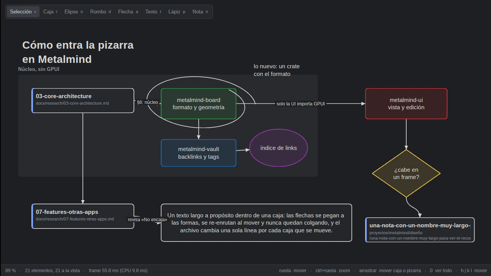
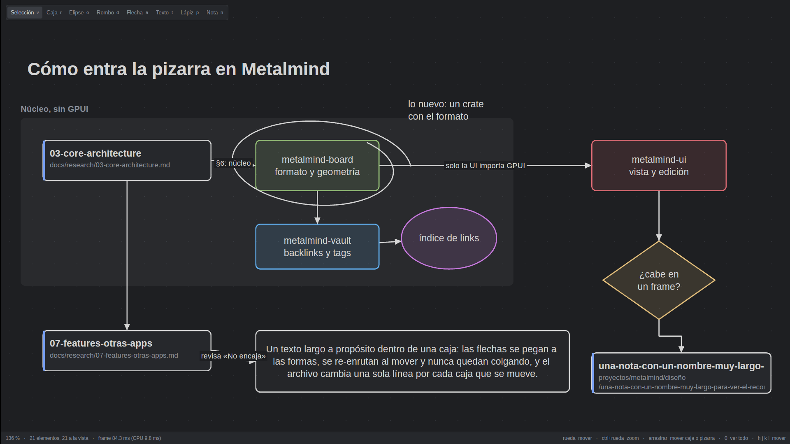
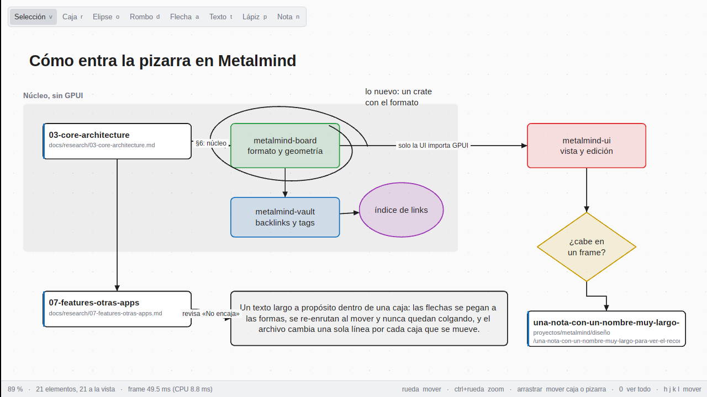
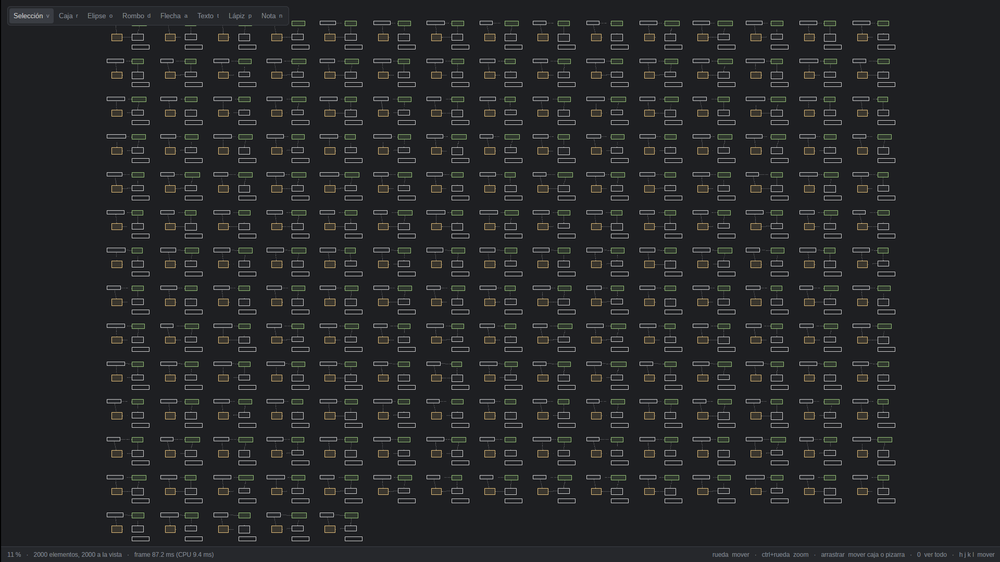
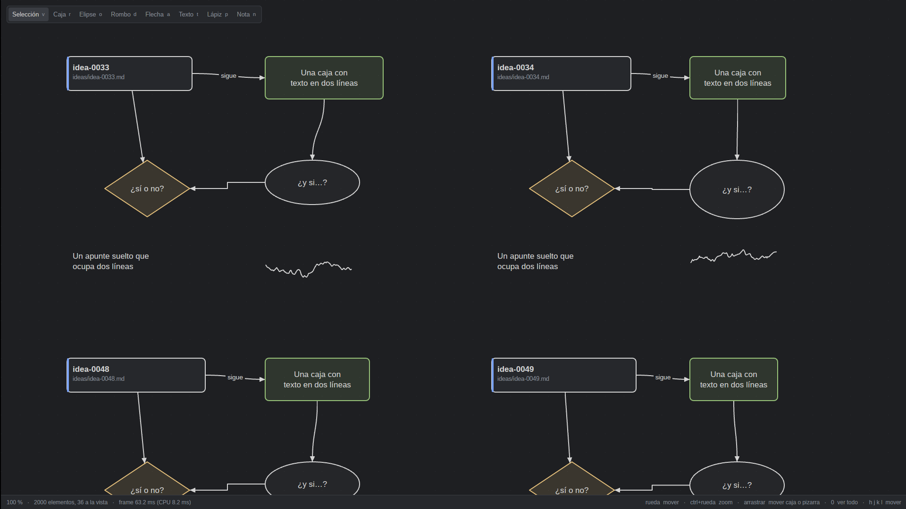
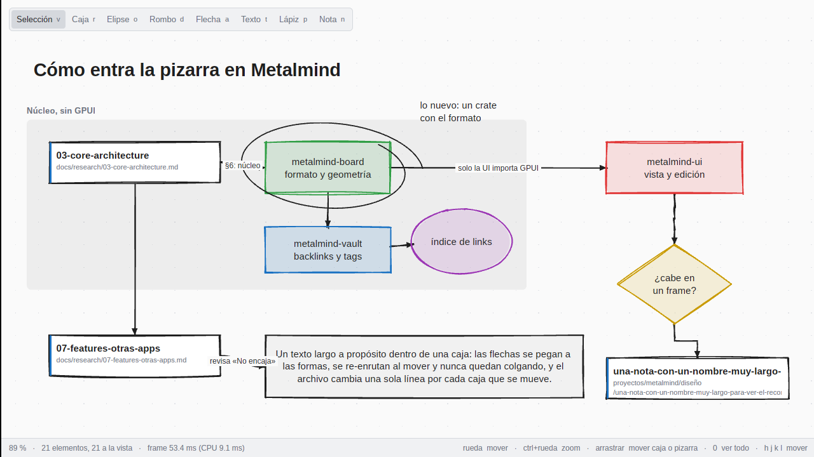

# 09 — Pizarra para pensar

> **Estado: propuesta.** Spike del 2026-10-26; la decisión es del autor en la PR. Revisa la fila "Canvas" de [07](07-features-otras-apps.md) §2.5, que lo dejó como "No encaja por ahora". Versiones, fechas y licencias de crates.io y GitHub de ese día. Los números son del spike, en release, en una máquina de escritorio x86_64 con Linux y GPU NVIDIA (la de [performance.md](../performance.md)). El código está en [`spikes/pizarra/`](../../spikes/pizarra/README.md), fuera del workspace: no toca el editor ni el binario.

## TL;DR

- **Qué es**: una pizarra infinita dentro de Metalmind para organizar ideas mientras se dibuja: cajas con texto, flechas que se pegan a las cajas, tarjetas que son notas del vault y trazo libre. Con prioridad en cajas y flechas (arquitectura, flujos, mapas de ideas) sobre el boceto. Fuera: diagramas como código (Mermaid, D2: no sirven para pensar mientras se dibuja) y embeber Excalidraw con JavaScript o un webview.
- **Formato (propuesta)**: **`.canvas`, JSON Canvas 1.0** (el de Obsidian, spec abierta, MIT) **con cuatro extensiones aditivas**: `shape` en los nodos de texto (elipse, rombo o texto suelto), `route` en las flechas (recta o en codo), un nodo `stroke` para el lápiz y sus puntos en texto compacto. Un elemento por línea, claves en orden fijo, y las claves que no conoce se conservan. Mover una caja con dos flechas cambia **una línea** del archivo; en el `.excalidraw` equivalente, el diff tiene **68 líneas**. El archivo pesa **14× menos** (303 KB frente a 4.1 MB con 2 000 elementos). Las tarjetas de notas son `type: "file"`, de primera clase en JSON Canvas.
- **`.excalidraw`**: no es el formato nativo (unos 30 campos por elemento, y `version`, `versionNonce` y `updated` cambian en cada edición), pero el spike lo lee y lo reescribe byte a byte como Excalidraw, y un convertidor **fuera de la app** pasa de uno al otro (§2.5).
- **Render**: nativo en GPUI, sin webview. Cada elemento se tesela una vez con lyon (que GPUI ya trae) en coordenadas de la pizarra; en cada frame solo se transforman los vértices. Con GPU, a 1920×1080: **60 fps** al 100 % con 500 y con 2 000 elementos, y al arrastrar una caja con sus flechas (re-enrutar cuesta 12 µs). Con toda la pizarra a la vista hace falta **nivel de detalle** (cada caja como un quad de GPUI): sin él, 2 000 elementos van a 20 fps y, en estilo a mano, **GPUI rechaza el frame** porque pasa del tope de 128 MB de su búfer de instancias.
- **Binario**: el visor suma **0.61 MB** a una ventana GPUI vacía; roughr, 0.11 MB más.
- **roughr** (port de rough.js): funciona y es determinista con la semilla sacada del id (no hay que guardar nada), pero duplica los triángulos (2.4×) y el tiempo de construir, y sin una letra a mano no se ve como Excalidraw. **Opcional, no por defecto.**
- **Edición** (diseño, §4): teclado primero con herramientas de una tecla (`v r o d a t p n`), texto de las cajas editado con el motor de vim, deshacer por elemento, todo como acciones `board::*` con su botón y su menú.
- **Recomendación** (§6): **sí, por fases**. Ver los `.canvas` (y que sean ciudadanos del vault: finder, backlinks, tags) junto a M5, porque los vaults de Obsidian ya los tienen; editar, como hito propio después del primer release.

---

## 1. Qué se pide y qué no

El autor quiere pensar dibujando dentro de Metalmind, como en Excalidraw o draw.io: cajas, flechas, texto y algo de trazo a mano mientras ordena ideas, sin salir del vault y con las notas como piezas del dibujo.

Descartado de entrada:

- **Diagramas como código** (Mermaid, D2, PlantUML): describen un diagrama que ya se tiene en la cabeza; no sirven para descubrirlo moviendo cajas.
- **Embeber Excalidraw** (su paquete de React en un webview, o JavaScript en un motor embebido): rompe la regla de una GUI nativa ([02](02-gui-stack.md)) y la de que todo sea una acción con nombre que el teclado y la paleta pueden invocar.

[07](07-features-otras-apps.md) §2.5 lo dejó como "No encaja por ahora" con la razón "es otra app dentro de la app". Este documento mide cuánto cuesta esa otra app y propone acotarla.

## 2. Formato en disco

### 2.1 Candidatos

| | `.excalidraw` | JSON Canvas (`.canvas`) | Propio |
|---|---|---|---|
| Quién lo abre | excalidraw.com, la app de Excalidraw, el plugin de Excalidraw de Obsidian (que usa además `.excalidraw.md` con el JSON comprimido) | Obsidian y las herramientas que implementan la spec ([jsoncanvas.org](https://jsoncanvas.org/), MIT, 3.7 k estrellas) | Solo Metalmind |
| Spec | No hay: es lo que serializa `packages/excalidraw/data/json.ts` (`JSON.stringify(datos, null, 2)`, comprobado en `b7de45e`, 2026-10-23) | Versión 1.0 (2024-03-11), una página | La que se escriba |
| Formas | Rectángulo, elipse, rombo, flecha, línea, lápiz, texto, imagen, frame | Nodos de texto (markdown), archivo, link y grupo; flechas entre nodos | Las que hagan falta |
| Flechas | Guardan sus puntos; la que está pegada además guarda a qué elemento | Siempre de un nodo a otro, sin coordenadas | — |
| Notas del vault | `link: "[[nota]]"` en un elemento (convención del plugin de Obsidian) | `type: "file"` con la ruta: de primera clase | — |
| Por elemento | ~30 claves, `version`, `versionNonce` y `updated` cambian en cada edición | 6 a 9 claves | — |

Lo que pesa para elegir: que el archivo se abra con otra herramienta, que el diff de git se lea, y que las tarjetas de notas sean de primera. JSON Canvas gana en las tres; le falta lo de dibujar (formas, flechas rectas o en codo, lápiz). Un formato propio no se abre en ningún lado, y `.excalidraw` hace diffs ilegibles y trata las notas como un link pegado a una caja.

### 2.2 Medidas

`cargo run --release --bin medir`, con el ejemplo de la pizarra (21 elementos, la de las capturas) y tableros generados de 500 y 2 000 elementos (60 % nodos, 40 % flechas; ver `generar.rs`). El `.excalidraw` es el **mismo contenido** pasado por el convertidor del §2.5, con todos los campos que escribe Excalidraw 0.18: cada caja lleva su texto como elemento aparte, y cada flecha, sus puntos.

| | `.canvas` | `.excalidraw` |
|---|---|---|
| El ejemplo (21 elementos) | 3 KB, 27 líneas | 39 KB, 1 842 líneas |
| 500 elementos | 75 KB, 506 líneas; se lee en 0.28 ms | 1 033 KB, 50 012 líneas; 4.0 ms |
| 2 000 elementos | 303 KB, 2 006 líneas; 1.7 ms | 4 137 KB, 200 000 líneas; 16.5 ms |
| Mover una caja con dos flechas pegadas | **2 líneas** (la de la caja, quitada y agregada), 200 bytes | 68 líneas, 1 615 bytes: `x`, `y`, `version`, `versionNonce` y `updated` de la caja, de su texto y de cada flecha, más los puntos y el tamaño de las flechas |
| Agregar un trazo de 80 puntos | 3 líneas (el nodo nuevo y la coma de la anterior), ~0.9–1.8 KB | 353 líneas, 6.8 KB (cada punto ocupa cuatro líneas) |

Y lo que dice un diff de `.canvas` al mover una caja:

```diff
-		{"id":"formato","type":"text","x":440,"y":180,"width":220,"height":90,"text":"**metalmind-board**\nformato y geometría","color":"4"},
+		{"id":"formato","type":"text","x":480,"y":160,"width":220,"height":90,"text":"**metalmind-board**\nformato y geometría","color":"4"},
```

Las flechas no cambian porque no guardan coordenadas: se recalculan de los nodos que unen (§3). Es la misma razón por la que mover una caja en Obsidian no toca sus flechas.

### 2.3 Propuesta: JSON Canvas con cuatro extensiones

Un `.canvas` de Obsidian se abre tal cual. Lo que JSON Canvas no tiene va como claves nuevas, siempre opcionales, que se escriben solo cuando difieren de lo que diría JSON Canvas:

| Extensión | Dónde | Valores | Sin ella |
|---|---|---|---|
| `shape` | nodo `text` | `ellipse`, `diamond`, `none` (texto suelto, sin caja) | `rectangle`, la caja de JSON Canvas |
| `route` | flecha | `straight`, `elbow` | la curva de Obsidian |
| `type: "stroke"` | nodo | `strokeWidth` y `points` | — (tipo nuevo) |
| `points` | nodo `stroke` | `"0,0 12,-3 15,-1,180"`: deltas en décimas de píxel, con la presión (0–255) opcional | — |

Lo que el formato decide para que la edición no tenga casos raros:

- **Una flecha siempre une dos nodos.** `fromSide` y `toSide` son opcionales: sin ellos el lado sale de la geometría y cambia al mover las cajas. Soltar una flecha en el vacío crea una caja ahí, como Obsidian. No hay flechas colgando que mantener. Una flecha de un nodo a sí mismo es un lazo en su esquina de arriba a la derecha; su `route` no cuenta y no se guarda.
- **El trazo es un nodo**, y su caja (`x`, `y`, `width`, `height`) es justo la de sus puntos, que van relativos a la esquina (entre 0 y el ancho o el alto; `Node::stroke` lo garantiza al crearlo o importarlo): se mueve, se selecciona y se agrupa como cualquier otro, y una flecha puede llegar a él. Los puntos van en la misma línea del nodo: medido, ponerlos en una sección aparte al final no hace el diff más chico (1 856 frente a 1 838 bytes al agregar un trazo) y parte un elemento en dos lugares del archivo. Con presión de lápiz caben los de una tableta, por si un día una app de tableta edita el mismo archivo.
- **Escritura canónica**: un elemento por línea, las claves en un orden fijo y las desconocidas (de Obsidian o de un plugin, como el `background` de un grupo) al final de su línea, sin tocar. Escribir dos veces da los mismos bytes. La semilla del trazo a mano sale del id: no se guarda.
- **Coordenadas enteras**, como pide JSON Canvas. Con una rejilla de 10 al mover, no se pierde nada.

Lo que **no está verificado**: qué hace Obsidian con un `.canvas` que trae `shape`, `route` o un nodo `stroke`. La spec no dice nada de claves o tipos extra. Lo esperable es que muestre una elipse como caja y no muestre los trazos; lo que importa es si al guardar **conserva** lo que no conoce. Hay que probarlo con Obsidian antes de decidir (riesgo 3 del §6). Si no los conserva, las extensiones siguen sirviendo para Metalmind, pero editar la misma pizarra en Obsidian perdería formas y trazos.

### 2.4 Tarjetas de notas

Una tarjeta es un nodo `file` con la ruta de la nota en el vault (`"file":"docs/research/03-core-architecture.md"`) y, si apunta a una sección, `subpath` (`"#Riesgos"`, como en JSON Canvas). Muestra el nombre de la nota y su ruta. Al ser una ruta y no un nombre, no hay ambigüedad que resolver, y renombrar una nota es reescribir esa línea (§5). Un `[[link]]` dentro del texto de una caja también es un link a la nota, como en cualquier nota.

### 2.5 `.excalidraw`: un convertidor aparte

La pizarra solo lee y escribe `.canvas`. Para traer o llevar dibujos de Excalidraw, un convertidor de línea de comandos fuera de la app (`spikes/pizarra/src/bin/convertir.rs` es el esbozo). Lo que pasa y lo que no:

| Excalidraw | Pizarra | Notas |
|---|---|---|
| `rectangle`, `ellipse`, `diamond` con su texto contenido (`containerId`) | nodo `text` con `shape` | El texto pasa; el estilo (relleno, aspereza, trazo punteado) no |
| `rectangle` con `link: "[[nota]]"` o `"[[nota#Sección\|alias]]"` | nodo `file` (`nota.md`, con `subpath`) | La convención del plugin de Obsidian. Un nombre con extensión de letras (`datos.csv`) va tal cual; sin extensión o con cifras tras el punto (`v1.2`), es una nota. Dentro de Metalmind lo decidiría el índice del vault |
| `rectangle` con otro `link` | nodo `link` | |
| `text` suelto | nodo `text` con `shape: "none"` | |
| `freedraw` | nodo `stroke` | La presión, si la hay |
| `arrow` pegada por los dos lados, con su texto | flecha con `label` | `elbowed`: codo; más de dos puntos: curva; si no, recta. Las puntas `arrow` y `triangle` son flecha; las demás (punto, barra, rombo) se pierden: JSON Canvas solo tiene flecha o nada |
| `frame` con `name` | `group` con `label` | |
| flecha suelta, `line`, `image`, lo demás | se lista y no se convierte | En la pizarra no hay flechas sueltas |
| un elemento que no se lee (le falta `x`, un campo tiene otro tipo) o con un id repetido | se lista y no se convierte | |
| un elemento girado (`angle`) | pasa sin el giro, y se avisa | La pizarra no gira formas |

Al revés, cada nodo se vuelve una forma con su texto, y cada flecha, un `arrow` pegado con los puntos que da la geometría del §3. Los anchos de texto los estima el convertidor: Excalidraw guarda el ancho que midió con su fuente. La ida y vuelta del ejemplo conserva nodos, flechas (con su recorrido), tarjetas (con su sección) y grupos (tests de `mapeo.rs`), y la captura de abajo es el visor abriendo el `.excalidraw` convertido. **No está verificado** abriendo el `.excalidraw` del spike en excalidraw.com; el lector sí reescribe byte a byte lo que guarda Excalidraw (test `rewrites_what_excalidraw_saved_byte_for_byte`).



## 3. Render nativo en GPUI

### 3.1 Cómo pinta el spike

- **Escena cacheada**: cada elemento se convierte una vez en mallas de triángulos de lyon (relleno y trazo, con tolerancia de 0.05 unidades) en coordenadas de la pizarra, más sus textos con el área que les toca. Mover la cámara no vuelve a teselar: en cada frame, cada vértice pasa por `(p − cámara) × zoom` y entra a un `Path` de GPUI con `push_triangle`, y `window.paint_path` lo manda a la GPU. GPUI 0.3.9 ya trae lyon (1.0.19), así que teselar no suma un crate.
- **Flechas**: se calculan de los nodos que unen (`geometria.rs`): el lado que mira hacia el otro nodo, el punto donde el rayo del centro cruza la silueta (rectángulo, elipse o rombo) para las rectas, y una curva o un codo de ángulos rectos para las demás. Mover una caja reconstruye su escena y la de sus flechas: **12 µs** (25 µs a mano).
- **Texto**: `shape_text` de GPUI con el tamaño en pantalla, partido al ancho de la caja y recortado a ella (una ruta sin espacios no se sale de su tarjeta). Por debajo de 3 px no se compone.
- **Nivel de detalle**: por debajo de un zoom de 0.35, cada nodo es un quad de GPUI (su caja con el relleno y el borde de su malla) en vez de su malla. De lejos no se distingue y es lo que hace caber una pizarra grande en un frame (abajo).
- **Orden**: flechas, nodos encima y al final las etiquetas de las flechas, para que una tarjeta no tape una etiqueta. Solo se pinta lo que cae en la ventana.





Las otras dos combinaciones: [oscuro, 1280×720](img/pizarra-oscuro-1280.png) y [claro, 1920×1080](img/pizarra-claro-1920.png).

### 3.2 Construir la escena

`medir`, mediana de 5:

| | Construir todo | Vértices | Mallas en memoria |
|---|---|---|---|
| 500 elementos, limpio | 2.9 ms | 72 k | 1.3 MB |
| 500 elementos, a mano | 5.8 ms | 174 k | 3.3 MB |
| 2 000 elementos, limpio | 13.1 ms | 286 k | 5.4 MB |
| 2 000 elementos, a mano | 26.9 ms | 695 k | 13.0 MB |

Abrir una pizarra de 2 000 elementos cuesta lo mismo que leer el archivo y un frame, sin contar los textos.

### 3.3 Frames

`./medir-frames.sh gamescope 1920x1080`: el visor corre dentro de `gamescope --backend headless`, un compositor sin pantalla que usa la GPU, así que no abre nada en el escritorio. La pantalla va a 60 Hz con vsync: un intervalo de 16.7 ms es "a tiempo". El guion (`--banco`) tiene cuatro fases de 180 frames. CPU es del `render` al último `paint`, sin el envío a la GPU. Con nivel de detalle:

| Fase | 500, limpio | 500, a mano | 2 000, limpio | 2 000, a mano |
|---|---|---|---|---|
| Toda la pizarra a la vista (zoom 0.22 con 500 y 0.11 con 2 000), pan lento | 16.7 / 17.1 ms, CPU 2.3 | 16.7 / 16.7 ms, CPU 2.9 | 16.7 / 16.7 ms, CPU 5.6 | **33.4** / 33.6 ms, CPU 8.0 |
| Zoom continuo hasta 3× y de vuelta | 16.7 / 16.8 ms, CPU 2.2 (p99 12.0) | 16.7 / 33.4 ms | 16.7 / 33.4 ms | 16.7 / 50.0 ms |
| Pan al 100 % (~50 elementos a la vista) | 16.7 / 17.1 ms, CPU 1.0 | 16.7 / 17.0 ms, CPU 1.3 | 16.7 / 16.7 ms, CPU 1.1 | 16.7 / 16.7 ms, CPU 1.3 |
| Arrastrar una caja con sus flechas, al 100 % | 16.7 / 17.2 ms, CPU 0.9 | 16.7 / 16.7 ms, CPU 1.3 | 16.7 / 16.9 ms, CPU 0.9 | 16.7 / 17.2 ms, CPU 1.1 |

Intervalo p50 / p99; CPU p50 en ms. **Sin nivel de detalle** (`DETALLE=no`), con toda la pizarra a la vista:

| | 500, limpio | 500, a mano | 2 000, limpio | 2 000, a mano |
|---|---|---|---|---|
| Intervalo p50 / p99 | 16.7 / 16.7 ms | 33.4 / 50.0 ms | 50.0 / 50.2 ms | **no pinta** |
| CPU p50 | 4.1 ms | 6.1 ms | 11.9 ms | — |
| Triángulos | 70 k | 168 k | 279 k | ~700 k |

Lo que dicen:

- **Al 100 %, que es donde se trabaja, sobra**: 60 fps con 500 y con 2 000 elementos, en los dos estilos, con 1 ms de CPU. Arrastrar una caja y re-enrutar sus flechas tampoco se nota.
- **De lejos, el cuello es la GPU**, no la CPU: sin nivel de detalle, 2 000 elementos limpios usan 12 ms de CPU pero el frame tarda 50 ms. GPUI rasteriza los paths en una textura intermedia y el spike manda uno por pieza (relleno, trazo); son caros cuando hay miles.
- **Tope duro de GPUI**: con 2 000 elementos a mano a la vista, GPUI registra `frame instance data exceeds the 134217728-byte maximum` y no pinta. Cada vértice de un path lleva su posición, sus coordenadas de curva y una máscara de recorte. El nivel de detalle no es una optimización opcional: sin él una pizarra grande no se puede ver entera.
- **Lo que queda lento**: 2 000 a mano de lejos va a 30 fps porque las flechas siguen siendo mallas a mano (151 k triángulos). Con su versión limpia de lejos, como las cajas, bajaría como el estilo limpio. Y los picos del zoom continuo (p99 de 33–50 ms, CPU p99 de 12–14 ms) son de componer los textos en cada tamaño nuevo: redondear el tamaño de la letra a pasos de medio píxel mientras dura el zoom deja que la caché de líneas de GPUI los reutilice.

Sin GPU (`./medir-frames.sh xvfb`, Xvfb con lavapipe, como el CI) todo es más lento, pero el reparto es el mismo: al 100 % 32 ms de intervalo y 1 ms de CPU con 500 y con 2 000 elementos; de lejos y sin nivel de detalle, 48 ms con 500 y 112 ms con 2 000 elementos limpios. Sirve para las capturas, no para medir.





### 3.4 Binario

`./medir-binario.sh`, release y sin símbolos (`strip`), contra una ventana GPUI vacía con lo mismo que enlaza el visor:

| | Tamaño | Suma |
|---|---|---|
| Ventana GPUI vacía | 26.37 MB | — |
| Visor, estilo limpio | 26.98 MB | **+0.61 MB** |
| Visor con roughr | 27.09 MB | +0.72 MB (roughr: **+0.11 MB**) |

Lo que suma es el código del formato, la geometría, la escena y el pintado: lyon, serde y serde_json ya están en el binario de Metalmind.

### 3.5 roughr: el trazo a mano

[roughr](https://crates.io/crates/roughr) 0.14.0 (2026-09-24, MIT, 44 k descargas; repo con 57 estrellas y un mantenedor) es el port a Rust de rough.js, el mismo que usa Excalidraw. Devuelve operaciones (`move`, `line`, `bezier`) que el spike pasa a caminos de lyon. Con la semilla sacada de un FNV-1a del id, el mismo elemento sale igual en cada apertura sin guardar `seed` (test `the_rough_stroke_is_the_same_every_time_and_differs_per_element`).



- **A favor**: pesa 0.11 MB y no trae nada raro (`euclid`, `palette`, `rand` 0.8, `svgtypes`).
- **En contra**: 2.4× triángulos y 2× tiempo de construir; con el texto en la letra de la interfaz se ve a medio camino. Excalidraw se ve como se ve por la letra (Excalifont y Virgil, OFL) tanto como por el trazo: habría que embeber una (unos cientos de KB).
- `perfect_freehand` 0.1.1 (el port de perfect-freehand, que Excalidraw usa para el lápiz) se probó en una primera versión del spike: funciona, pero es muy joven (2 k descargas). El lápiz del spike es una curva suavizada de ancho fijo, que basta para subrayar y encerrar.

**Propuesta**: estilo limpio por defecto y el estilo a mano como opción por pizarra o global, en una fase tardía. No condiciona nada del formato: la semilla sale del id.

### 3.6 Crates verificados (crates.io, 2026-10-26)

| Crate | Versión | Publicado | Licencia | Uso |
|---|---|---|---|---|
| `lyon` | 1.0.19 | 2026-03-08 | MIT / Apache-2.0 | Teselar; ya lo trae GPUI 0.3.9 |
| `roughr` | 0.14.0 | 2026-09-24 | MIT | Trazo a mano (opcional) |
| `rough_tiny_skia`, `rough_piet` | 0.14.0 / 0.15.0 | 2026-09-24 | MIT | Adaptadores de roughr a otros motores; no hacen falta |
| `perfect_freehand` | 0.1.1 | 2026-01-27 | MIT | Lápiz con presión; probado y descartado por ahora |
| `serde_json` (`preserve_order`) | 1.0.154 | 2026-10-11 | MIT / Apache-2.0 | Leer `.excalidraw` sin cambiar el orden de sus claves |
| `similar` | 3.2.1 | 2026-10-24 | Apache-2.0 | Solo para medir diffs en el spike |

## 4. Edición mínima viable (diseño)

El spike no edita más que lo necesario para medir: arrastrar una caja (con rejilla de 10), crear una caja o una elipse con `r` u `o` y un clic, y la barra de herramientas con la tecla de cada una. Lo que sigue es el diseño de la edición, para estimar la fase 3.

### 4.1 Herramientas y teclas

La pizarra es un contexto del keymap (`Board`) con sus acciones `board::*`, como el árbol de archivos tiene `file_tree::*`. Las teclas de una letra siguen a Excalidraw donde no chocan con vim:

| Tecla | Acción | Con el ratón |
|---|---|---|
| `v` | `board::tool_select` | botón de la barra |
| `r`, `o`, `d` | `board::tool_rectangle`, `tool_ellipse`, `tool_diamond`: el siguiente clic (o `enter`, en el centro de la vista) crea la forma y vuelve a `v` | botón; arrastrar dibuja con el tamaño |
| `a` | `board::tool_arrow`: con un nodo seleccionado, `h j k l` crea una caja nueva hacia ese lado unida por una flecha (el gesto de un mapa mental); `f` y la letra que aparece sobre cada nodo visible (como el `f` de Vimium) la une a uno que ya existe | arrastrar desde el borde de un nodo; soltar en el vacío crea una caja |
| `t` | `board::tool_text`: texto suelto (`shape: "none"`) | botón |
| `p` | `board::tool_pencil` | arrastrar dibuja |
| `n` | `board::insert_note_card`: abre el finder (`space f`) y la nota elegida entra como tarjeta | arrastrar una nota del árbol a la pizarra |
| `i`, `enter` | `board::edit_text` en una caja; en una tarjeta, `enter` y `gd` abren la nota (`board::open_note`) | doble clic |
| `h j k l` | mover la selección 10 unidades (`board::move_selection`); sin selección, la vista | arrastrar |
| `H J K L` | seleccionar el vecino hacia ese lado (`board::select_neighbor`) | clic |
| `x`, `delete` | `board::delete` | menú contextual |
| `y`, `p` en Visual, `P` | copiar y pegar elementos: el portapapeles lleva sus líneas de `.canvas` | menú contextual |
| `u`, `ctrl-r` | `board::undo`, `board::redo` | menú Editar |
| `+`, `-`, `shift-1`, `shift-0` | zoom, ver todo, 100 % (los de Excalidraw) | `ctrl`+rueda |

`p` como lápiz choca con "pegar" de vim: en la pizarra `p` es el lápiz y pegar es `P`, porque se dibuja más de lo que se pega. Es la única tecla discutible.

### 4.2 Convivencia con vim

- **En la pizarra no hay buffer**, así que el motor de vim no recibe teclas y las de una letra quedan libres. `space` (el líder), `:` y `ctrl-w` siguen siendo de la ventana: `space f` abre el finder, `:w` guarda, `:q` cierra, `ctrl-w v` parte la vista.
- **Escribir dentro de una caja es vim**: `i` abre el texto de la caja en un buffer chico con `metalmind-vim` (Insert al final), con todos sus motions, operadores, registros y el IME. `Esc` en Normal vuelve a la pizarra. Así no hay un segundo editor de texto con sus propias reglas. El contexto es `Board > TextEdit`.
- **Una sola lista de acciones**: todo es `board::*` en `metalmind_keymap::Action`, así que aparece en la paleta con su atajo, y la barra y el menú contextual muestran la tecla de cada botón ([design.md](../design.md)).

### 4.3 Deshacer y guardar

- **Deshacer por elemento**: como cada elemento es una línea, un paso del historial es una lista de `(id, línea antes, línea después)`. Mover tres cajas son tres pares; deshacer los invierte. Editar el texto de una caja usa el historial de vim mientras se edita y, al salir, entra como un solo paso.
- **Guardar** como las notas: autoguardado con debounce y escritura atómica ([03](03-core-architecture.md) §5). El diff de un guardado es el de las líneas tocadas (§2.2), así que el historial de versiones de [06](06-decisiones-de-fondo.md) §3 sirve sin cambios.

### 4.4 Alinear

Rejilla de 10 al mover y al crear (el spike la tiene) y guías de alineación con los vecinos: bordes y centros a menos de 6 px en pantalla se pegan y se dibuja la guía. Las flechas se re-enrutan solas; el texto de las cajas se parte al ancho de la caja.

## 5. Integración con el vault

- **Un crate de núcleo, `metalmind-board`** (sin GPUI): el formato, la geometría de las flechas, el acierto de clic y las operaciones de edición con su historial. Lo que hoy es `formato.rs`, `trazo.rs` y `geometria.rs`. El teselado y el pintado van en `metalmind-ui`: deciden cómo se ve. Agregar el crate actualiza la lista de [03](03-core-architecture.md) §6 y la de CLAUDE.md.
- **El vault**: un `EntryKind::Board` para los `.canvas`, junto a `Note` y `Attachment`. El finder, el árbol y `:e idea.canvas` lo abren en la vista de pizarra.
- **Links y backlinks**: el índice de links (03 §4, "Estado (M3…)") lee de una pizarra los nodos `file` (ruta exacta, sin resolver nombres) y los `[[links]]` del texto de sus nodos, con el mismo scanner de `metalmind-syntax`. Los backlinks de una nota muestran la pizarra con el texto de los nodos unidos a la tarjeta como contexto.
- **Tags**: un `#tag` en el texto de un nodo es un tag de la pizarra, como en una nota, y la pizarra aparece en el panel de tags.
- **Renombrar una nota** reescribe el `file` de cada tarjeta que la apunta: una línea por tarjeta, con la vista previa de renombrar.
- **Embeber** `![[idea.canvas]]` en una nota (con la infraestructura de embeds de M5): una vista de solo lectura con toda la pizarra a la vista y nivel de detalle, de alto fijo (`![[idea.canvas|400]]` para cambiarlo). `enter`, `gd` o un clic la abren a pantalla completa para editar. `[[idea.canvas]]` es un link normal.
- **CLI**: `metalmind search` y `tags` incluyen las pizarras; `--json` da la ruta y el id del nodo.

## 6. Costo, riesgos y recomendación

### Fases

| Fase | Qué | Tamaño |
|---|---|---|
| 1. Ver | `metalmind-board` (formato y geometría, con los tests del spike), la vista de solo lectura a pantalla completa con pan, zoom y nivel de detalle, `EntryKind::Board` en el finder y el árbol | M: 3–4 PRs |
| 2. Índice | Backlinks desde las tarjetas, links y tags en el texto de los nodos, renombrar actualiza las tarjetas | S: 2 PRs |
| 3. Editar | Selección, mover, crear formas, flechas con ratón y teclado, texto con el motor de vim, borrar, copiar y pegar, deshacer, autoguardado, rejilla y guías, barra y menú contextual, acciones `board::*` | L: 5–7 PRs |
| 4. Embeber | `![[x.canvas]]` en las notas, sobre los embeds de M5 | S: 1–2 PRs |
| 5. Extras | Lápiz con presión, grupos editables, colores, estilo a mano con su letra, el convertidor de `.excalidraw` como script | Según se pidan |

### Riesgos

1. **Paths de GPUI**: el tope de 128 MB por frame y el costo de miles de paths obligan al nivel de detalle desde la fase 1 (medido en §3.3). `Path` y `push_triangle` son API pública pero de bajo nivel, y `gpui-pre` cambia cada semana; se mitiga como el resto, con la versión fijada (04, riesgo 9). Si un día el costo de los paths molesta, el siguiente paso es pintar la pizarra lejana como imagen (tiny-skia, que GPUI ya trae) en el executor de fondo.
2. **Texto dentro de las cajas**: el motor de vim con un buffer por caja es un anfitrión nuevo para `metalmind-vim` (alto variable, partir al ancho de la caja, IME). Es la parte más cara de la fase 3.
3. **Obsidian y las extensiones** (§2.3, sin verificar): si Obsidian borra lo que no conoce al guardar, editar la misma pizarra en los dos lados pierde formas y trazos. Se prueba antes de la fase 1; si falla, las extensiones se quedan igual y se documenta que Obsidian solo las ve.
4. **Que crezca**: [07](07-features-otras-apps.md) la descartó por ser "otra app dentro de la app". Las fases acotan: sin imágenes, sin colaboración, sin capas ni estilos por elemento más allá del color, y el boceto (lápiz, trazo a mano) al final.
5. **Letra a mano**: si se quiere el aspecto de Excalidraw, hay que embeber una fuente OFL y elegir cuál.

### Recomendación

**Sí, por fases:**

- **Fases 1 y 2 junto a M5** ("el vault se ve como en Obsidian"): los vaults de Obsidian ya tienen `.canvas`, y hoy Metalmind los muestra como adjuntos. Verlos y que sus tarjetas cuenten como backlinks cuesta poco (5–6 PRs, nada de edición) y no depende de decidir la edición.
- **Fase 3 como hito propio después del primer release** (03 §8, después de M6): es lo caro y no bloquea nada del MVP. La fase 4 entra cuando estén las fases 1 y 3, porque reutiliza la vista de solo lectura.
- **El formato se decide ya** (en esta PR, si el autor está de acuerdo): JSON Canvas con las cuatro extensiones del §2.3, sujeto a probar Obsidian (riesgo 3).

## 7. Cómo reproducirlo

```sh
cd spikes/pizarra
cargo test --release && cargo test --release --examples
cargo run --release --bin medir                       # §2.2 y §3.2
./medir-frames.sh gamescope 1920x1080                 # §3.3, con GPU
DETALLE=no ./medir-frames.sh gamescope 1920x1080      # §3.3, sin nivel de detalle
./medir-binario.sh                                    # §3.4
cargo run --release --example pizarra -- ejemplos/arquitectura.canvas
```

Las capturas, con `./capturar.sh` (Xvfb y lavapipe, como las del editor): `ejemplos/arquitectura.canvas` en las cuatro combinaciones de tema y tamaño, `--mano --claro`, el `.excalidraw` convertido y `--tablero 2000` de lejos y al 100 % (`--camara 2600,1200,1`).
